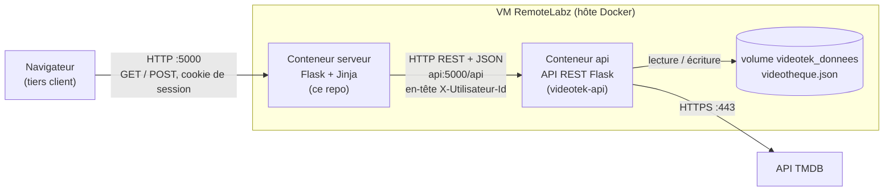
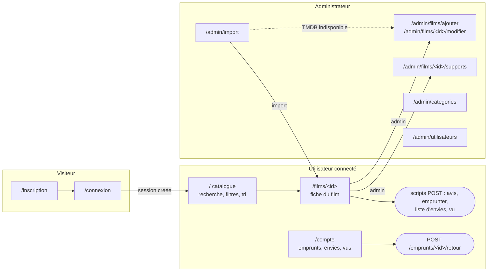
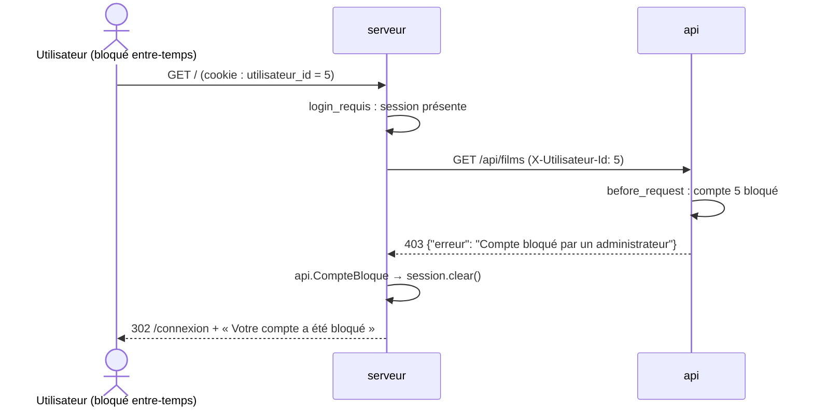

# videotek-serveur — tiers présentation de la vidéothèque

Site web Flask + Jinja du TP **RT0705 « Gestion d'une vidéothèque »**. C'est le
**tiers présentation** d'une application web 3 tiers : il génère les pages
HTML, traite les formulaires, gère la session et le rôle de l'utilisateur, et
appelle l'API REST du repo
[videotek-api](https://github.com/L4Curtis/videotek-api) (tiers données) pour
toute lecture ou écriture.

Ce repo contient aussi le **`docker-compose.yml` global**, qui crée ensemble
les deux conteneurs (`api` et `serveur`).

## Architecture



| Élément | Rôle | Détails |
|---|---|---|
| Image `videotek-flask:1.0` | Image commune aux deux conteneurs | `python:3.12-slim` + Flask, requests, bcrypt ; utilisateur non root ; code monté en volume. `Dockerfile` identique dans les deux repos ; le compose global la construit **une seule fois** (service `serveur`) et le conteneur `api` la réutilise |
| Conteneur `serveur` | Pages HTML, formulaires, session, rôle | port 5000 publié (`5000:5000`), démarre quand l'API est prête (`depends_on` + healthcheck) |
| Conteneur `api` | API REST, règles métier, fichier JSON, TMDB | port 5001 publié pour les tests (`5001:5000`), clé TMDB en variable d'environnement |
| Réseau `videotheque_net` | Réseau bridge interne | le serveur joint l'API par son nom : `http://api:5000` (DNS de Docker) |
| Volume `videotek_donnees` | Fichier JSON de production | conservé si le conteneur est recréé |

## Plan du site

Les **pages** affichent un template Jinja ; les **scripts** (routes POST)
traitent un formulaire ou un bouton, appellent l'API puis redirigent avec un
message de confirmation ou d'erreur (flash).



Chaque script redirige vers une page (fiche, Mon compte, page d'administration)
avec un message ; `GET /deconnexion` vide la session et revient à la connexion.

| Page ou script (route) | Opérations | Appels à l'API |
|---|---|---|
| Connexion — `GET, POST /connexion` | Formulaire ; si l'API accepte, crée la session et redirige vers le catalogue | `POST /api/connexion` |
| Inscription — `GET, POST /inscription` | Formulaire ; vérifie que les deux mots de passe sont identiques, puis redirige vers la connexion | `POST /api/utilisateurs` |
| Déconnexion (script) — `GET /deconnexion` | Vide la session | — |
| Catalogue — `GET /` | Recherche (titre, acteur), filtres (année, genre), tri ; cartes des films (affiche, titre, année, note) | `GET /api/films?q&annee&categorie&tri`, `GET /api/categories` |
| Fiche — `GET /films/<id>` | Infos, supports et disponibilité, note moyenne, avis ; boutons Emprunter, Liste d'envies, Vu ; formulaire d'avis ; admin : Modifier, Supprimer, Supports | `GET /api/films/<id>`, `GET /api/categories`, `GET /api/utilisateurs/<id>` |
| Avis (script) — `POST /films/<id>/avis` | Envoie note et commentaire | `POST /api/films/<id>/avis` |
| Emprunt (script) — `POST /emprunter/<support_id>` | Affiche la date de retour prévue ou le refus | `POST /api/emprunts` |
| Envies / vu (script) — `POST /envies/<film_id>`, `POST /vus/<film_id>` | Ajoute ou retire selon le bouton, retour à la page d'origine | `POST`/`DELETE /api/utilisateurs/<id>/envies/<film_id>` (ou `/vus/`) |
| Mon compte — `GET /compte` | Profil, emprunts en cours (retard signalé, bouton Rendre), historique, liste d'envies, films vus | `GET /api/utilisateurs/<id>`, `GET /api/emprunts?utilisateur_id=<id>`, `GET /api/films` |
| Retour (script) — `POST /emprunts/<id>/retour` | Rend le film | `PUT /api/emprunts/<id>/retour` |
| Ajout / modification — `GET, POST /admin/films/ajouter`, `/admin/films/<id>/modifier` | Formulaire (titre, année, genres à cocher, acteurs, description, affiche), prérempli en modification | `GET /api/categories`, `GET /api/films/<id>`, `POST /api/films` ou `PUT /api/films/<id>` |
| Suppression (script) — `POST /admin/films/<id>/supprimer` | Refus affiché si un support est emprunté | `DELETE /api/films/<id>` |
| Supports — `GET, POST /admin/films/<id>/supports` | Liste (avec l'emprunteur), ajout, modification, suppression | `GET /api/films/<id>`, `GET /api/emprunts`, `POST /api/films/<id>/supports`, `PUT`/`DELETE /api/supports/<id>` |
| Catégories — `GET, POST /admin/categories` | Ajout, renommage, suppression ; nombre de films par genre | `GET`/`POST /api/categories`, `PUT`/`DELETE /api/categories/<id>`, `GET /api/films` |
| Import TMDB — `GET, POST /admin/import` | Recherche par titre, bouton Importer ; lien vers l'ajout manuel si TMDB échoue | `GET /api/tmdb?titre=`, `POST /api/tmdb/import` |
| Utilisateurs — `GET /admin/utilisateurs`, `POST /admin/utilisateurs/<id>/bloquer` | Comptes et statut, Bloquer / Débloquer (pas son propre compte) | `GET /api/utilisateurs`, `PUT /api/utilisateurs/<id>/bloque` |

## Session, rôles et compte bloqué

La session Flask est un cookie **signé** (`CLE_SECRETE`) qui contient
`utilisateur_id`, `nom_utilisateur` et `role`. Les décorateurs `login_requis`
et `admin_requis` protègent les pages ; chaque appel à l'API transmet
l'identifiant dans l'en-tête `X-Utilisateur-Id`. Si l'administrateur bloque un
compte, la prochaine action de cet utilisateur reçoit un 403 de l'API : le
serveur vide sa session et le renvoie vers la connexion.



Autres protections : jeton **CSRF** dans chaque formulaire POST, cookie
`HttpOnly` et `SameSite=Lax`, redirections limitées aux chemins du site,
échappement automatique de Jinja.

## Démarrage

Prérequis sur la VM : `docker`, `docker compose`, `git`.

```bash
mkdir -p ~/videothek && cd ~/videothek
git clone https://github.com/L4Curtis/videotek-api.git
git clone https://github.com/L4Curtis/videotek-serveur.git

cp videotek-api/.env.example videotek-api/.env     # VIDEOTHEQUE_FICHIER, TMDB_CLE
cp videotek-serveur/.env.example videotek-serveur/.env
python3 -c "import secrets; print(secrets.token_hex(32))"   # valeur de CLE_SECRETE

cd videotek-serveur
docker compose up -d --build
docker compose ps
```

- Site : <http://10.11.16.145:5000> · pages de test : <http://10.11.16.145:5000/test/>
- API (tests) : <http://10.11.16.145:5001/api>
- Par défaut l'API utilise les données de **préproduction** (comptes de test
  dans le [README de l'API](https://github.com/L4Curtis/videotek-api#préproduction-et-production)).
- En **production** (`VIDEOTHEQUE_FICHIER=/donnees/videotheque.json`), créer le
  premier administrateur : `docker compose exec api python creer_admin.py <nom>`.

| Variable | Fichier | Rôle |
|---|---|---|
| `CLE_SECRETE` | `videotek-serveur/.env` | Signe le cookie de session |
| `API_URL` | `docker-compose.yml` | Adresse de l'API : `http://api:5000/api` |
| `VIDEOTHEQUE_FICHIER`, `TMDB_CLE` | `videotek-api/.env` | Voir le repo de l'API |

Le code est monté en volume et Flask tourne avec `--reload` : une modification
d'un fichier sur la VM est prise en compte sans reconstruire l'image.

## Pages de test du conteneur

Demandées par le sujet pour valider l'image Flask avant le développement
(blueprint [`test_conteneur.py`](test_conteneur.py), sans appel à l'API) :

| Route | Contenu |
|---|---|
| `/test/simple` | Une page HTML simple |
| `/test/formulaire` | Un formulaire, traité en Python, résultat affiché par un template Jinja (conditions, boucles, filtres) |
| `/test/videotheque` | Un template Jinja qui exploite le fichier JSON [`exemples/videotheque.json`](exemples/videotheque.json), avec filtre par genre |

## Tests

```bash
# tests unitaires du serveur (API simulée)
docker compose exec serveur python -m pytest -v

# scénario de bout en bout sur les deux conteneurs lancés (préproduction)
python3 tests/e2e.py http://localhost:5000
```

- [`tests/test_serveur.py`](tests/test_serveur.py) : 29 tests pytest (contrôle
  d'accès, session, compte bloqué, CSRF, pages, scripts, appels envoyés à l'API).
- [`tests/e2e.py`](tests/e2e.py) : parcours complet comme un navigateur
  (inscription, connexion, recherche, emprunt, retour, avis, listes,
  administration, blocage d'un compte connecté, import TMDB, pages de test).

## Structure du repo

```text
videotek-serveur/
├── app.py               routes des pages et des scripts, login_requis / admin_requis, CSRF
├── api.py               appels à l'API avec requests (renvoient JSON + code de retour)
├── test_conteneur.py    pages de test du conteneur (/test/...)
├── templates/
│   ├── base.html        gabarit : en-tête, menu selon le rôle, messages flash
│   ├── _macros.html     affiche, étoiles de notation
│   ├── connexion.html, inscription.html, catalogue.html, film.html, compte.html
│   ├── admin_film.html, admin_supports.html, admin_categories.html,
│   │   admin_import.html, admin_utilisateurs.html, erreur.html
│   └── test/            pages de test du conteneur
├── static/style.css     mise en forme
├── exemples/videotheque.json   données de la page de test Jinja
├── tests/               conftest.py, test_serveur.py, e2e.py
├── Dockerfile           image commune videotek-flask:1.0 (identique dans les 2 repos)
├── docker-compose.yml   création coordonnée des conteneurs api + serveur
├── .env.example
├── requirements.txt
└── AGENTS.md            consignes pour faire évoluer le projet
```
